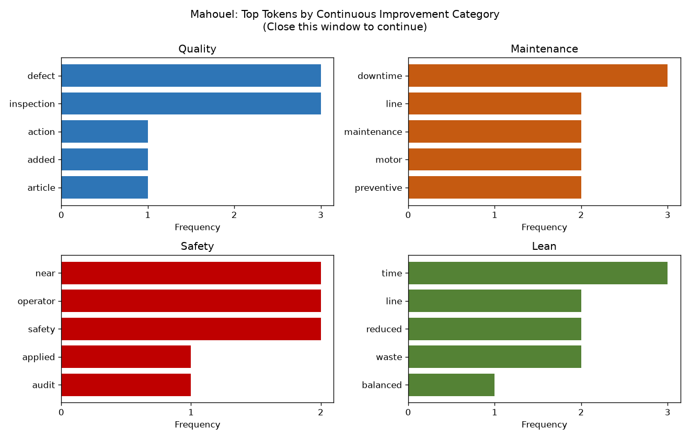

# nlp-03-text-exploration

[](pyproject.toml)
[](https://github.com/AbdelhafidhMahouel/nlp-03-text-exploration/actions/workflows/ci-python-zensical.yml)
[](https://abdelhafidhmahouel.github.io/nlp-03-text-exploration/)

[](https://docs.astral.sh/uv/)
[](https://docs.astral.sh/ty/)
[](https://zensical.org/)
[](LICENSE)

> Explore text corpora using token frequencies, categories, and contextual patterns,
> then apply the same techniques to manufacturing continuous improvement reports.

## Project Overview

Author: Abdelhafidh Mahouel

Date: 2026 November

Third project in the Web Mining and Applied NLP course.

This project introduces exploratory text analysis.
It starts from a working example (dogs, cats, cars, trucks),
makes a technical modification to how word context is measured,
and then applies the same techniques to a new problem:
**manufacturing continuous improvement and process engineering**.

The project contains two analyses that run independently:

| Script | Corpus | Purpose |
|---|---|---|
| [src/nlp/nlp_corpus_explore.py](src/nlp/nlp_corpus_explore.py) | 22 example documents (dogs, cats, cars, trucks) | Original example plus the Phase 4 window-size modification |
| [src/nlp/nlp_corpus_explore_abdel.py](src/nlp/nlp_corpus_explore_abdel.py) | 24 shop-floor reports in [data/ci_reports_abdel.csv](data/ci_reports_abdel.csv) | Phase 5 custom project on continuous improvement |

The project is configured in
[pyproject.toml](pyproject.toml).

## Data

### Example Corpus

The example uses a small, controlled text corpus
defined directly in the Python script:
22 short documents in four categories (dogs, cats, cars, trucks).

### Custom Corpus: Manufacturing Continuous Improvement

The custom project uses its own dataset file,
[data/ci_reports_abdel.csv](data/ci_reports_abdel.csv),
kept separate from the code.

It contains 24 short, fictional shop-floor reports written in the style of
real plant documentation, with three columns: `doc_id`, `category`, and `text`.

| Category | Documents | Written like | Example |
|---|---|---|---|
| quality | 6 | Quality alerts and corrective actions | "The root cause of the defect was a worn fixture at station four." |
| maintenance | 6 | Maintenance work orders | "Preventive maintenance replaced the worn bearing before a breakdown." |
| safety | 6 | Safety observations and audits | "Lockout tagout was not applied before clearing the jam on the line." |
| lean | 6 | Kaizen and lean event summaries | "Kaizen event reduced changeover time from forty to twelve minutes." |

Some shop-floor words (line, operator, station, parts) appear in several
categories on purpose, so co-occurrence can show how the same word
is used differently depending on context.

No web connection is required.

## Approach

The project uses Python and Polars
to explore patterns in a labeled text corpus.

The example demonstrates:

- Representing a collection of documents as a corpus.
- Tokenizing and cleaning text.
- Computing global token frequencies.
- Comparing token frequencies across categories.
- Identifying frequently occurring words within categories.
- Examining word co-occurrence using context windows.
- Creating and counting bigrams.
- Visualizing and interpreting token distributions.

Explore these important project components:

- [pyproject.toml](pyproject.toml) - project identity, dependencies, and tool configuration.
- [src/nlp/nlp_corpus_explore.py](src/nlp/nlp_corpus_explore.py) - example corpus analysis (with Phase 4 modification).
- [src/nlp/nlp_corpus_explore_abdel.py](src/nlp/nlp_corpus_explore_abdel.py) - custom manufacturing CI analysis (Phase 5).
- [data/ci_reports_abdel.csv](data/ci_reports_abdel.csv) - custom labeled corpus.
- [tests/](tests/) - automated tests for both scripts.
- [.github/workflows/](.github/workflows/) - automated testing and documentation deployment.
- [docs/](docs/) - project documentation.
- [zensical.toml](zensical.toml) - documentation configuration.

The goal is to observe structure in text
before applying machine learning or language models.

## Phase 4: Technical Modification (Context Window Size)

**File:** [src/nlp/nlp_corpus_explore.py](src/nlp/nlp_corpus_explore.py) (Section 7)

### What Changed

The original example hard-coded a single context window of 2 tokens.
The co-occurrence logic is now wrapped in a reusable function,
`build_co_occurrence(documents, window_size)`,
and the script compares window sizes **2 and 3** side by side
for the target words dog, cat, car, and truck.
For each target it prints the number of context tokens,
the unique context words, and which words are new at the larger window.

The default window of 2 is still used for the rest of the analysis,
so the original results and tests are unchanged.

### Why

The window size controls how many tokens on each side of a target word
count as its context. Making it a parameter turns a single result
into an experiment, and the function can be reused and tested.

### What We Observed

| Target | Window 2 | Window 3 | New words at window 3 |
|---|---|---|---|
| dog | 7 context tokens | 9 context tokens | kennel |
| cat | 8 | 9 | (none) |
| car | 8 | 11 | road |
| truck | 7 | 9 | engine, loads |

- A small window captures tight grammatical neighbors (barks, drives, hauls).
- A larger window adds topic words that describe meaning (kennel, road, engine).
- "cat" gained nothing because its sentences are short; a window of 2 already covered them.
- Larger windows also pull in more filler, so the best size depends on document length.

## Phase 5: Custom Project (Manufacturing Continuous Improvement)

**Files:**
[src/nlp/nlp_corpus_explore_abdel.py](src/nlp/nlp_corpus_explore_abdel.py),
[data/ci_reports_abdel.csv](data/ci_reports_abdel.csv),
[tests/test_smoke_abdel.py](tests/test_smoke_abdel.py)

### Analytical Question

Can simple text techniques surface the vocabulary that separates
quality, maintenance, safety, and lean reports, and point an engineer
toward recurring problems, before any model is used?

### What Changed From the Example

| Area | Example | Custom project |
|---|---|---|
| Data | Hard-coded in the script | Loaded from a separate CSV with Polars |
| Categories | dog, cat, car, truck | quality, maintenance, safety, lean |
| Cleaning | Lowercase, strip punctuation, drop short tokens | Same, plus **stop-word removal** (the, and, was, found, ...) |
| Category comparison | Top tokens per category | Plus a **token spread table**: which words are shared across categories vs. unique to one |
| Co-occurrence targets | dog, cat, car, truck | line, operator, defect, downtime, waste (window 2 vs. 3) |
| Bigrams | Global counts | Global counts plus **repeated bigrams by category** |
| Visualization | One bar chart (dog only) | **2x2 panel** comparing all four categories, saved to `docs/images/` |
| Tests | Original smoke test | New test file for the custom script; original test kept |

The data path is built from the script's own location,
so the script and the tests find the CSV from any working folder.

### Key Results

Top tokens per category (after stop-word removal):

| Category | Top tokens |
|---|---|
| Quality | defect, inspection, action, added, article |
| Maintenance | downtime, line, maintenance, motor, preventive |
| Safety | near, operator, safety, applied, audit |
| Lean | time, line, reduced, waste, balanced |



- **Shared words:** "line" appears in all four categories and "operator" in three.
- **Context changes meaning:** "line" sits next to downtime, conveyor, and unplanned
  in maintenance reports, but next to cycle time and balanced in lean reports.
  "operator" appears near near miss and ergonomic risk in safety reports
  and near motion waste in lean.
- **Bigrams recover engineering terms:** preventive maintenance, hydraulic press, root cause.
  "hydraulic press" appears in both maintenance and safety reports,
  linking an equipment problem (oil leak) to a hazard (slip risk).

### Interpretation and Limitations

- Each improvement area has a clear vocabulary fingerprint, so these techniques
  could help sort or route free-text reports without reading every one.
- Stop-word removal was essential: without it, "the" dominates every category.
- Stop-word removal can also create **false bigrams**: "parts line" comes from
  "parts from line" and "parts closer to the line".
- Frequency shows what people **write about**, not how severe, costly,
  or urgent a problem is. A frequent word is not necessarily the biggest problem.
- The corpus is small and fictional, so results are sensitive to wording.
  A real analysis would need many more reports.

## Run the Project

Follow the [Professional Python Workflow Guide](https://denisecase.github.io/pro-analytics-02/)
to set up your machine and project environment.

From a VS Code terminal in the project root:

```shell
# Example analysis with the Phase 4 window-size comparison
uv run python -m nlp.nlp_corpus_explore

# Custom manufacturing continuous improvement analysis (Phase 5)
uv run python -m nlp.nlp_corpus_explore_abdel
```

Close each visualization window after viewing
so the script can continue executing.

## Results

The analysis produces frequency distributions,
category comparisons, co-occurrence information,
and bigram frequencies.

Successful execution produces:

```shell
========================
Pipeline executed successfully!
========================
```

A `project.log` file is created in the project root.
The custom script also saves its chart to
`docs/images/ci_top_tokens_by_category_abdel.png`.

## Verification

Run the automated tests for both scripts:

```shell
uv run python -m pytest
```

Expected: `2 passed`, covering
[tests/test_smoke.py](tests/test_smoke.py) (example) and
[tests/test_smoke_abdel.py](tests/test_smoke_abdel.py) (custom project).

## Project Documentation

The [hosted documentation site](https://abdelhafidhmahouel.github.io/nlp-03-text-exploration/)
is published using Zensical and GitHub Pages.

The documentation site is used to present the project report,
covering such sections as data, methods, results, visualizations,
interpretation, and conclusions.

## CI/CD and GitHub Actions

This project includes continuous integration and continuous deployment (CI/CD)
to check project files and publish the docs.

GitHub Actions include:

- [CI: Python and Documentation Checks](https://github.com/AbdelhafidhMahouel/nlp-03-text-exploration/actions/workflows/ci-python-zensical.yml)
- [CD: Documentation Deployment](https://github.com/AbdelhafidhMahouel/nlp-03-text-exploration/actions/workflows/deploy-zensical.yml)

## Developer Reference

Follow the
[Professional Python Workflow Guide](https://denisecase.github.io/pro-analytics-02/)
for **detailed instructions and troubleshooting**.

### Initialize and Update the Python Environment

With the project open in VS Code, open a VS Code terminal.
Paste each command and hit Enter or Return after to run it.

```shell
uvx pup-clean --delete
uv self update
uv python pin 3.14
uv python install
uv lock --upgrade
uv sync
uv audit
```

### Set Up and Run Git Hooks

Set up and run the git hooks to perform
basic checks automatically before
any changes get pushed to GitHub.

In the VS Code terminal,
paste each command and hit Enter or Return after to run it.

```shell
uvx prek install --force
uvx prek update --freeze --cooldown-days 7

git add -A
uvx prek run --all-files
# repeat if changes were made
uvx prek run --all-files
```

### Run Common Chores

Run linters, formatters, type checks, tests, and
build the documentation.

```shell
uv run ruff check . --fix
uv run ruff format .

uv run ty check
uv run python -m pytest
uv run python -m zensical build
```

### Git add-commit-push to GitHub

After making useful changes, save your work to GitHub.

```shell
git add -A
git commit -m "describe your changes in quotes"
git push -u origin main
```

## Developer Notes

- Use the **UP ARROW** and **DOWN ARROW** in the terminal to scroll through past commands.
- Use `CTRL+f` to find (and replace) text within a file.

## Developer Tools

This project uses professional Python tools to support development,
testing, documentation, and code quality.

- [uv](https://docs.astral.sh/uv/) - Python environments and dependencies.
- [Ruff](https://docs.astral.sh/ruff/) - Python linting and formatting, configured in [.ruff.toml](.ruff.toml).
- [ty](https://docs.astral.sh/ty/) - Python type checking.
- [pytest](https://docs.pytest.org/) - automated Python testing, configured in [.pytest.toml](.pytest.toml).
- [prek](https://prek.j178.dev/) - Git hooks and automated checks, configured in [prek.toml](prek.toml).
- [Zensical](https://zensical.org/) - project documentation, configured in [zensical.toml](zensical.toml).

## Links

- [Hosted Documentation](https://abdelhafidhmahouel.github.io/nlp-03-text-exploration/)
- [Professional Python Workflow Guide](https://denisecase.github.io/pro-analytics-02/)
- [Citation](CITATION.cff)
- [License](LICENSE)
